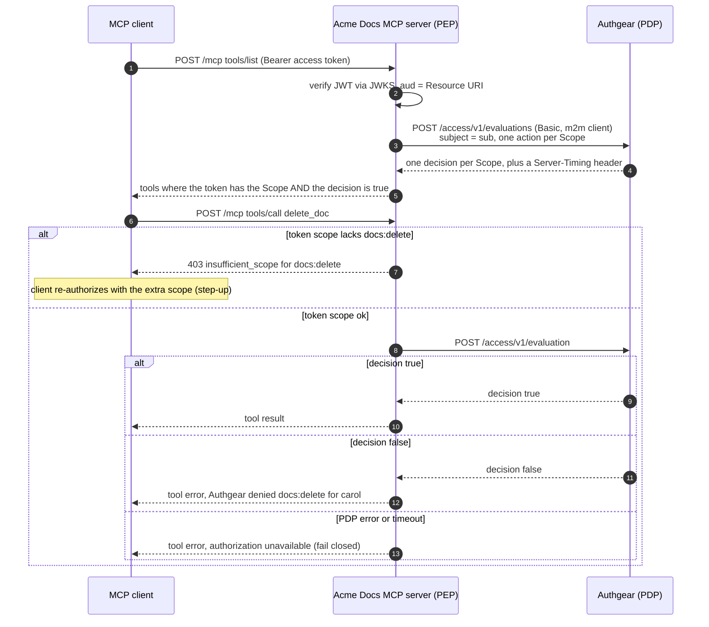

# Acme Docs: an MCP server guarded by the Authgear Authorization Decision API

A small, self-contained MCP server that shows what the [Authorization Decision API](../../docs/specs/authorization-pdp.md) is for. Three people sign in through Authgear from the same MCP client and see **different tools** and **different outcomes**. Authgear decides, and you can change the decision live from the portal with no redeploy.

| User | Role (via) | Permissions on `https://docs.acme.localhost` |
|---|---|---|
| alice | `docs_admin` (direct) | `docs:read` `docs:write` `docs:delete` `docs:publish` |
| bob | `docs_editor` (via group `writers`) | `docs:read` `docs:write` |
| carol | `docs_viewer` (direct) | `docs:read` |

| Tool | Required Scope |
|---|---|
| `search_docs`, `read_doc` | `docs:read` |
| `create_doc`, `update_doc` | `docs:write` |
| `delete_doc` | `docs:delete` |
| `publish_doc` | `docs:publish` |

Everything here is example code: documents live in memory, and the Decision Console has no login. Do not expose it beyond localhost.

- The server binds `127.0.0.1` by default. Set `HOST=0.0.0.0` only if you understand the console is then reachable by anyone on the network.
- `/console` is unauthenticated and demo-only. Never expose it.
- JWT verification pins `RS256` (`jwtVerify` algorithms), so tokens signed with any other algorithm are rejected.

## How it works

A tool is usable only when **both** of these hold:

1. **Token scope**: the access token's `scope` contains the tool's Scope. This is what the user consented to let the MCP client do.
2. **PDP decision**: Authgear answers `true` for this user and Scope. This is whether the user holds the Permission, through any of their roles or groups.



Notes:

- Authorization runs **per request**, never per connection. The server is stateless and builds the tool list from fresh decisions each time.
- The server authenticates to the PDP in **client mode**: HTTP Basic with an `m2m` client that is associated with the Resource. The subject is the token's `sub`.
- Any non-`200` from the PDP, or a network failure, is a denial. A decision of `true` is never assumed.
- `Server-Timing: pdp;dur=<ms>;desc="cache-hit|cache-miss"` feeds the latency and cache tiles in the console.

## Prerequisites

- Node.js 20.12 or later
- A local Authgear (see "Start local development environment" in the repo [`CLAUDE.md`](../../CLAUDE.md)) running a build that includes the Authorization Decision API
- A local project created with `authgear init` (its Admin API key is read from `authgear.secrets.yaml`)

## Walkthrough

### 1. Start local Authgear

```sh
docker compose up -d
make start          # main server
make start-portal   # portal backend
(cd portal && npm start)
```

### 2. Configure the project and seed it

```sh
cd examples/mcp-authz-demo
npm install && npm run setup
# restart `make start` so Authgear loads the new clients, then:
npm run seed
```

`npm run setup` edits the files `authgear init` created (`AUTHGEAR_CONFIG`, default `../../var/authgear.yaml`; `AUTHGEAR_SECRETS`, default `../../var/authgear.secrets.yaml`; or `--config` / `--secrets`). It merges [`authgear.yaml.snippet`](./authgear.yaml.snippet) (the `m2m` PDP client, a first-party native demo client, the `username` login ID key next to the existing ones, email by default), generates the PDP client secret, and writes `.env`. It skips what already exists, backs up any file it changes to `.backup/`, and is safe to re-run. `npm run seed` needs the restarted server, because it associates the new `m2m` client with the Resource.

Manual fallback: merge the snippet yourself, generate a secret with `openssl rand -hex 24`, put it in `.env` as `PDP_CLIENT_SECRET` and in `authgear.secrets.yaml` as the `oauth.client_secrets` item from the snippet (`k` is base64url, no padding), then `cp .env.example .env`, fill in `ADMIN_API_KEY_ID` and `ADMIN_API_PRIVATE_KEY_JWK` (or `_PEM`) from the Admin API key, and run `npm run seed`.

`npm run seed` is idempotent and prints each user's ID (the token `sub`). It creates the Resource and its Scopes, the three roles with their permissions, the `writers` group, the three users (password `Demo1234!`), and associates the `m2m` client with the Resource. The Resource and Scopes allow first-party clients (static and dynamic), so a client such as Claude Code, which registers itself with CIMD or DCR, can request them.

### 3. Start the server and open the console

```sh
npm start
```

Open <http://localhost:4100/console> (the server listens on `HOST`, default `127.0.0.1`, port `PORT`, default `4100`). The console has no login and is demo-only. Keep it visible for the rest of the walkthrough.

### 4. See three different tool lists

```sh
npm run demo -- --all
```

For each user a browser opens; sign in with the username and `Demo1234!`. On a headless machine add `--no-browser` and open the printed URL yourself. The script then lists the tools and calls every one in order (create, update, publish, delete on a document it creates, so allowed calls succeed), and prints a table like:

```
=== carol ===
tool          scope         listed  call result
------------  ------------  ------  -----------------------------------------------------------
search_docs   docs:read     yes     ok      - incident-runbook: Incident Response Runbook [published]
read_doc      docs:read     yes     ok      # Engineering Handbook [published] ...
create_doc    docs:write    no      DENIED  Authgear denied `docs:write` for carol (role grants: docs:read)
...
```

Use `--user bob` for a single user, `--scope docs:read` to narrow the token (the token-scope half of the rule), and `--no-browser` to print the sign-in URL only.

### 5. Change a permission live

1. In the portal go to **User Management → Roles → `docs_viewer` → Permissions** and tick `docs:write`.
2. Re-run `npm run demo -- --user carol`.
3. `create_doc` and `update_doc` now appear and succeed. No redeploy, no new token. The decision API sees the change as soon as it commits (cache invalidation).
4. Untick it and run again to see them disappear. Watch the console: allow ratio and cache hit ratio move as the decisions change.

The token's `scope` claim does not change, because Permissions are answered only by the PDP. That is why the server has to ask.

### 6. Connect Claude Code

```sh
claude mcp add --transport http acme-docs http://localhost:4100/mcp
```

Run `/mcp` in Claude Code and authenticate. The server advertises only `docs:read` in its [protected resource metadata](http://localhost:4100/.well-known/oauth-protected-resource). Ask Claude to create a document and it receives `403 insufficient_scope`, which triggers a step-up to `docs:write`. After that, whether the call succeeds is up to the PDP.

> Resource URI. `RESOURCE_URI` defaults to `https://docs.acme.localhost`, the Authgear Resource identifier and the token `aud`. Some MCP clients require the advertised `resource` to match the server URL they connect to. If your client refuses to continue, create the Resource with the server URL instead (for example `http://localhost:4100/mcp`) by setting `RESOURCE_URI` before `npm run seed` and `npm start`.

## Decision Console

`/console` is one static page with live updates over Server-Sent Events. It follows your light or dark setting and works on a narrow screen.

- **Decisions / min**: PDP calls in the last minute.
- **Allow ratio**: share of tool calls the PDP allowed, over the last 5 minutes.
- **p50 / p95 latency**: PDP latency from `Server-Timing`, or the measured round trip if the header is missing.
- **Cache hit ratio**: from the `desc` of `Server-Timing`. The `desc` (cache-hit/cache-miss) is sent only when the Authgear server runs with `DEV_MODE=true`; otherwise these tiles stay empty and the console degrades gracefully.
- **Why?** links to the Roles page in the portal. The text beside it says what was decided and by which permissions.

## Scripts

| Command | What it does |
|---|---|
| `npm start` | Run the MCP server and the console. |
| `npm run dev` | Same, restarting on file changes. |
| `npm run setup` | Merge the demo config into your local Authgear files and write `.env`. |
| `npm run seed` | Create the demo Resource, Scopes, roles, group, users and grants. |
| `npm run demo -- --all` | Sign in as each user and print the tools and call results. |
| `npm run typecheck` | Type-check the TypeScript. |
| `npm run build` | Compile to `dist/` (run it with `node dist/server.js`). |

Settings are in [`.env.example`](./.env.example).

## Files

| File | Purpose |
|---|---|
| `src/server.ts` | Express app, Streamable HTTP MCP endpoint, `tools/list` filtering, `tools/call` enforcement. |
| `src/auth.ts` | JWT verification (JWKS, issuer, `aud`) and `WWW-Authenticate` challenges. |
| `src/pdp.ts` | AuthZEN client: evaluation and batch evaluations, Basic auth, `Server-Timing` parsing. |
| `src/tools.ts` | Tool table: name, Scope, input schema, handler. |
| `src/store.ts` | In-memory documents with sample content. |
| `src/console/` | Decision Console: event bus and statistics, SSE route, static page. |
| `scripts/setup-local.ts` | Merge the snippet into local config, generate the PDP secret, write `.env`. |
| `scripts/seed.ts` | Provision Authgear through the Admin API. |
| `scripts/demo-client.ts` | Scripted MCP client (authorization code with PKCE). |

## Learn more

- [Authorization Decision API spec](../../docs/specs/authorization-pdp.md)
- [API Resources and Scopes](../../docs/specs/api-resource.md)
- [Roles and Groups](../../docs/specs/roles-groups.md)
- [OpenID AuthZEN Authorization API 1.0](https://openid.net/specs/authorization-api-1_0.html)
